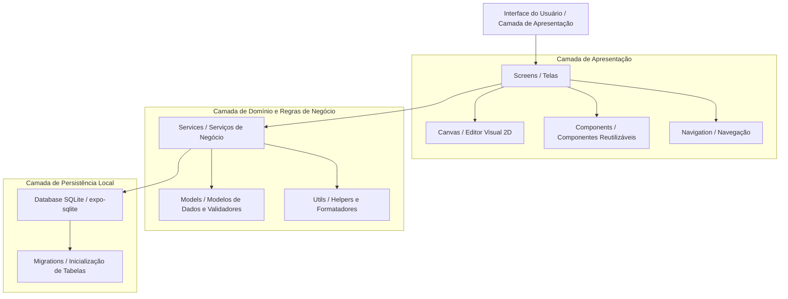
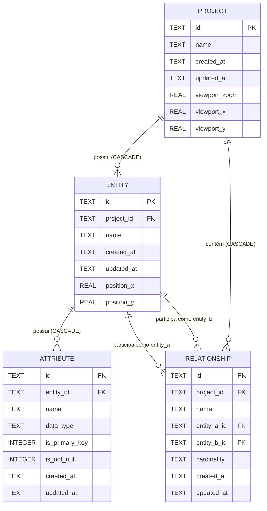

# Documento de Arquitetura de Software — BRMM (BRModelo Mobile)
## 1. Visão Geral da Arquitetura

O **BRMM (BRModelo Mobile)** adota uma arquitetura em camadas orientada a componentes, com abordagem **Local-First (100% Offline)**. Toda a computação, manipulação de regras de negócio e armazenamento residem exclusivamente no dispositivo móvel do usuário.

### 1.1. Escopo da Modelagem
O MVP foca na **modelagem relacional lógica** de bancos de dados:
- Criação e gestão de projetos isolados.
- Criação de entidades (tabelas) com nomes únicos por projeto.
- Definição de atributos com tipos relacionais (`INTEGER`, `VARCHAR`, `TEXT`, `REAL`, `DECIMAL`, `BOOLEAN`, `DATE`, `DATETIME`), indicador de chave primária (`PK`) e nulidade (`NOT NULL`).
- Estabelecimento de relacionamentos estruturados entre entidades com cardinalidades (`1:1`, `1:N`, `N:N`).
- **Editor Visual Canvas 2D** com posicionamento livre de entidades no plano bidimensional, arraste interativo e viewport persistente (zoom e posição salvos por projeto).
- **Fora do escopo:** Geração automática de scripts SQL/DDL externos e sincronização em nuvem.



---

## 2. Decisões Tecnológicas e Justificativas

| Tecnologia | Decisão | Justificativa |
| :--- | :--- | :--- |
| **Interface Mobile** | **React Native + Expo** | Permite desenvolvimento multiplataforma (Android e iOS) com excelente performance de renderização nativa, ciclo ágil de desenvolvimento via Expo Go e amplo ecossistema de bibliotecas estáveis. |
| **Linguagem** | **JavaScript (ES6+)** | Elimina complexidade de configuração e etapas de compilação adicionais no MVP, garantindo prototipagem rápida e aderência direta às diretrizes do projeto. |
| **Persistência Local** | **SQLite (`expo-sqlite`)** | Banco de dados relacional embarcado no próprio dispositivo. Fornece ACID completo, integridade referencial com chaves estrangeiras, consultas eficientes e persistência segura em arquivo local sem custo de infraestrutura. |
| **Backend Remoto** | **Nenhum (100% Local)** | O MVP tem como objetivo central a modelagem individual no dispositivo móvel. A ausência de backend remoto simplifica a arquitetura, reduz custos e garante funcionamento estritamente offline com máxima privacidade. |
| **Testes Automatizados** | **`node:test` (runner nativo do Node.js)** | Runner de testes nativo do Node.js, sem dependências externas. Permite execução de testes unitários e de integração de serviços, validadores e lógica de negócios de forma leve e direta. |
| **Controle de Versão** | **Git + GitHub** | Controle de versões distribuído, rastreabilidade de commits semânticos e base para automação de pipelines. |

---

## 3. Organização de Diretórios e Módulos

A aplicação Expo está centralizada no diretório `brmodelo-mobile/`, com a seguinte estrutura lógica:

```
brmodelo-mobile/
├── assets/                     # Ícones, fontes e recursos visuais estáticos
├── src/
│   ├── components/             # Componentes visuais reutilizáveis (botões, modais, cartões)
│   │   └── canvas/             # Componentes do Editor Visual Canvas 2D
│   │       ├── EntityNode.js           # Nó visual de entidade no canvas (arrastável)
│   │       ├── RelationshipLink.js     # Linha de conexão entre entidades relacionadas
│   │       ├── CanvasToolbar.js        # Barra de ferramentas do canvas (zoom, centralizar)
│   │       ├── CanvasWorkspace.js      # Área de trabalho principal com pan/zoom
│   │       └── SelectedElementDrawer.js # Drawer inferior de detalhes do elemento selecionado
│   ├── screens/                # Telas da aplicação (HomeScreen, ProjectScreen, EntityScreen, etc.)
│   ├── navigation/             # Configurações de navegação de telas
│   ├── database/               # Conexão SQLite, migrations DDL e execução de queries
│   │   └── migrations/
│   │       └── 002_canvas_visual_editor.js  # Migração: colunas de posição e viewport
│   ├── models/                 # Definições de entidades, contratos de dados e esquemas
│   ├── services/               # Regras de negócio (ProjectService, EntityService, RelationshipService)
│   ├── hooks/                  # React Hooks customizados para gerenciamento de estado e ciclo de vida
│   ├── utils/                  # Funções utilitárias (validações, formatação de datas)
│   └── constants/              # Constantes do sistema (tipos de dados de atributos, cardinalidades, temas)
├── App.js                      # Ponto de entrada do aplicativo Expo
├── app.json                    # Metadados e configurações da plataforma Expo
└── package.json                # Manifesto de dependências e scripts do Node.js
```

### Responsabilidades das Camadas:
- **`screens/`**: Telas de visualização que orquestram a interface e invocam os serviços.
- **`components/`**: Elementos de UI desacoplados (ex.: `ProjectCard`, `AttributeItem`, `ConfirmModal`).
- **`components/canvas/`**: Componentes especializados do Editor Visual Canvas 2D (nós de entidade, links de relacionamento, toolbar e workspace com pan/zoom).
- **`services/`**: Concentra a lógica de validação de negócios (ex.: validação de nomes únicos, verificação de entidades antes de relacionar) e orquestra chamadas ao banco.
- **`database/`**: Inicializa o arquivo SQLite local, executa scripts de criação de tabelas e expõe operações SQL parametrizadas.
- **`utils/`**: Funções puras de formatação de data, validação de inputs e sanitização de texto.

---

## 4. Modelagem de Dados Local (Schema SQLite)

O banco de dados SQLite interno do aplicativo armazena as estruturas criadas pelo usuário. O esquema relacional é composto por 4 tabelas de domínio e 1 tabela de metadados para versionamento:



### 4.1. Definições das Tabelas DDL

1. **Tabela de Controle `__migrations`:**
   ```sql
   CREATE TABLE IF NOT EXISTS __migrations (
       id INTEGER PRIMARY KEY AUTOINCREMENT,
       version INTEGER UNIQUE NOT NULL,
       name TEXT NOT NULL,
       applied_at TEXT NOT NULL
   );
   ```

2. **Tabela `projects`:**
   ```sql
   CREATE TABLE IF NOT EXISTS projects (
       id TEXT PRIMARY KEY NOT NULL,
       name TEXT NOT NULL CHECK(length(trim(name)) > 0),
       created_at TEXT NOT NULL,
       updated_at TEXT NOT NULL
   );
   ```

3. **Tabela `entities`:**
   ```sql
   CREATE TABLE IF NOT EXISTS entities (
       id TEXT PRIMARY KEY NOT NULL,
       project_id TEXT NOT NULL,
       name TEXT NOT NULL CHECK(length(trim(name)) > 0),
       created_at TEXT NOT NULL,
       updated_at TEXT NOT NULL,
       FOREIGN KEY (project_id) REFERENCES projects(id) ON DELETE CASCADE,
       UNIQUE (project_id, name COLLATE NOCASE),
       UNIQUE (id, project_id)
   );
   ```

4. **Tabela `attributes`:**
   ```sql
   CREATE TABLE IF NOT EXISTS attributes (
       id TEXT PRIMARY KEY NOT NULL,
       entity_id TEXT NOT NULL,
       name TEXT NOT NULL CHECK(length(trim(name)) > 0),
       data_type TEXT NOT NULL CHECK(data_type IN ('INTEGER', 'VARCHAR', 'TEXT', 'REAL', 'DECIMAL', 'BOOLEAN', 'DATE', 'DATETIME')),
       is_primary_key INTEGER NOT NULL DEFAULT 0 CHECK(is_primary_key IN (0, 1)),
       is_not_null INTEGER NOT NULL DEFAULT 0 CHECK(is_not_null IN (0, 1)),
       created_at TEXT NOT NULL,
       updated_at TEXT NOT NULL,
       FOREIGN KEY (entity_id) REFERENCES entities(id) ON DELETE CASCADE,
       UNIQUE (entity_id, name COLLATE NOCASE)
   );
   ```

5. **Tabela `relationships`:**
   ```sql
   CREATE TABLE IF NOT EXISTS relationships (
       id TEXT PRIMARY KEY NOT NULL,
       project_id TEXT NOT NULL,
       name TEXT,
       entity_a_id TEXT NOT NULL,
       entity_b_id TEXT NOT NULL,
       cardinality TEXT NOT NULL CHECK(cardinality IN ('1:1', '1:N', 'N:N')),
       created_at TEXT NOT NULL,
       updated_at TEXT NOT NULL,
       CHECK (entity_a_id <> entity_b_id),
       FOREIGN KEY (project_id) REFERENCES projects(id) ON DELETE CASCADE,
       FOREIGN KEY (entity_a_id, project_id) REFERENCES entities(id, project_id) ON DELETE CASCADE,
       FOREIGN KEY (entity_b_id, project_id) REFERENCES entities(id, project_id) ON DELETE CASCADE
   );
   ```

### 4.2. Regras de Integridade e Decisões de Modelagem
- **Integridade Referencial Composta:** As chaves estrangeiras `(entity_a_id, project_id)` e `(entity_b_id, project_id)` referenciam a chave única composta `(id, project_id)` da tabela `entities`. Isso impede a inserção de relacionamentos entre entidades de projetos distintos diretamente na engine do SQLite.
- **Unicidade Case-Insensitive:** As restrições `UNIQUE (project_id, name COLLATE NOCASE)` e `UNIQUE (entity_id, name COLLATE NOCASE)` impedem a criação de nomes duplicados que variem apenas por maiúsculas/minúsculas.
- **Restrição de Autorrelacionamento no MVP:** O `CHECK (entity_a_id <> entity_b_id)` proíbe relacionamentos reflexivos no MVP.
- **Tipos de Dados Relacionais Permitidos:** `INTEGER`, `VARCHAR`, `TEXT`, `REAL`, `DECIMAL`, `BOOLEAN`, `DATE`, `DATETIME`.
- **Cardinalidades Aceitas:** `1:1`, `1:N`, `N:N`.
- **Política de Exclusão (CASCADE):**
  - A exclusão de um projeto remove em cascata todas as suas entidades, atributos e relacionamentos.
  - A exclusão de uma entidade remove em cascata todos os seus atributos e todos os relacionamentos em que ela participe como `entity_a` ou `entity_b`.
  - A exclusão de um atributo não afeta outros atributos nem a entidade pai.

### 4.3. Estratégia de Inicialização e Migrations
- **Inicialização Idempotente:** A função `initDatabase()` executa `PRAGMA foreign_keys = ON;`, verifica a tabela de controle `__migrations` e aplica apenas as migrações cujo número de versão ainda não esteja registrado.
- **Transacionalidade:** Cada migração é executada dentro de uma transação atômica (`withTransactionAsync`). Se ocorrer qualquer erro, o `ROLLBACK` é acionado e a versão não é registrada.
- **Persistência de Versão:** Além do registro na tabela `__migrations`, o `PRAGMA user_version` nativo do SQLite é atualizado.

### 4.4. Migração 002 — Editor Visual Canvas 2D
A migração `002_canvas_visual_editor` estende o esquema do banco para suportar o posicionamento espacial de entidades e a persistência do viewport do canvas por projeto.

- **Colunas adicionadas na tabela `entities`:**
  - `position_x REAL DEFAULT 100` — coordenada X da entidade no canvas.
  - `position_y REAL DEFAULT 100` — coordenada Y da entidade no canvas.
- **Colunas adicionadas na tabela `projects`:**
  - `viewport_zoom REAL DEFAULT 1.0` — nível de zoom do canvas.
  - `viewport_x REAL DEFAULT 0` — posição X do viewport (deslocamento horizontal).
  - `viewport_y REAL DEFAULT 0` — posição Y do viewport (deslocamento vertical).
- **Idempotência:** A migração verifica as colunas existentes via `PRAGMA table_info` antes de executar cada `ALTER TABLE ADD COLUMN`, evitando erros em execuções repetidas.
- **Valores padrão:** Os defaults (`100` para posições de entidade, `1.0` para zoom, `0` para offsets de viewport) garantem que entidades pré-existentes apareçam em posição válida e visível no canvas, sem necessidade de intervenção manual do usuário.

---

## 5. Estratégia de Versionamento Git e GitHub

- **Branch Principal (`main`):** Contém código estável, testado e documentado.
- **Branches de Funcionalidade (`feature/<nome-funcionalidade>`):** Branches criadas a partir da `main` para desenvolvimento isolado de cada funcionalidade.
- **Branches de Correção (`fix/<nome-da-correcao>`):** Para correção pontual de defeitos identificados.
- **Padrão de Mensagens de Commit (Conventional Commits):**
  - `feat: adiciona criacao de entidades no project service`
  - `fix: corrige validacao de campos em branco no formulario de atributos`
  - `docs: adiciona especificacao de casos de uso`
  - `test: implementa testes unitarios para validacao de relacionamento`

---

## 6. Plano de Testes Automatizados

1. **Testes de Persistência e Regras de Negócio:**
   - Suíte automatizada com 15 cenários em `tests/persistence.test.js`.
   - Valida contra banco SQLite real em memória (`useMemory: true`), cobrindo integridade referencial, constraints compostas, ordenações, concorrência, idempotência e deleção em cascata.
2. **Testes de Relacionamentos:**
   - Suíte automatizada em `tests/relationship.test.js`.
   - Cobre criação, validação de cardinalidades, restrições de autorrelacionamento e cascata de exclusão.
3. **Testes de Atributos:**
   - Suíte automatizada em `tests/attribute.test.js`.
   - Valida tipos de dados, constraints de unicidade, flags PK/NOT NULL e operações CRUD de atributos.
4. **Testes do Canvas — Migração e Persistência:**
   - Suíte automatizada em `tests/canvas.test.js`.
   - Valida a migração 002, persistência de posições de entidade (`position_x`, `position_y`) e viewport de projeto (`viewport_zoom`, `viewport_x`, `viewport_y`).
5. **Testes do Canvas — Componentes Visuais:**
   - Suíte automatizada em `tests/canvas-components.test.js`.
   - Valida renderização e interação dos componentes do Editor Visual Canvas 2D (EntityNode, RelationshipLink, CanvasToolbar, CanvasWorkspace).
- **Total: 5 suítes, 33 testes.** Todas executadas com o runner nativo do Node.js (`node --test tests/**/*.test.js`), sem dependências externas.

---

## 7. Pipeline de CI/CD (GitHub Actions) e Planejamento DevSecOps

### 7.1. Pipeline de Integração Contínua (CI)
Será configurado em `.github/workflows/ci.yml` quando os testes e linters forem ativados no projeto:
- **Gatilhos:** Execução automática em `push` na branch `main` e em qualquer `pull_request`.
- **Passos do Pipeline:**
  1. *Checkout* do repositório.
  2. Configuração do ambiente Node.js (versão LTS).
  3. Instalação das dependências (`npm ci`).
  4. Execução de linting estático com ESLint (`npm run lint`).
  5. Auditoria de vulnerabilidades de dependências (`npm audit --audit-level=high`).
  6. Execução de testes automatizados unitários (`npm test`).

### 7.2. Práticas de DevSecOps
- **Auditoria Contínua de Dependências:** Uso periódico do `npm audit` para mitigar vulnerabilidades em pacotes de terceiros.
- **Prevenção de SQL Injection:** Uso absoluto de consultas preparadas (*prepared queries*) com passagem de parâmetros por tuplas e placeholders (`?`), nunca concatenando strings diretamente em instruções SQL.
- **Sanitização e Validação no Cliente:** Validação de formato, comprimento máximo e restrições de nulidade antes de atingir a camada de banco de dados.
- **Privacidade por Design (Privacy-by-Design):** O aplicativo não requer dados pessoais nem comunicações com servidores externos no MVP, preservando integralmente a privacidade do usuário no dispositivo.
