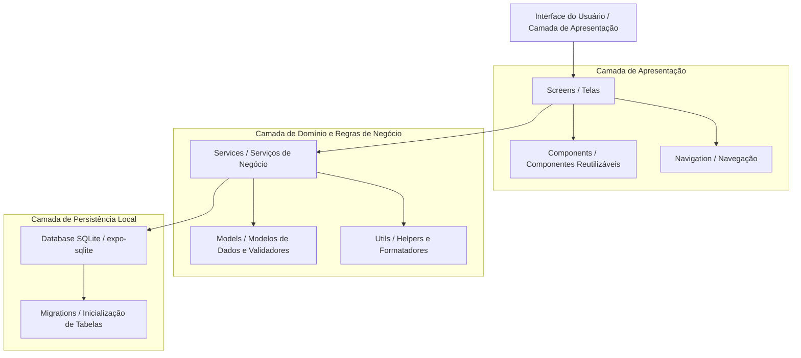
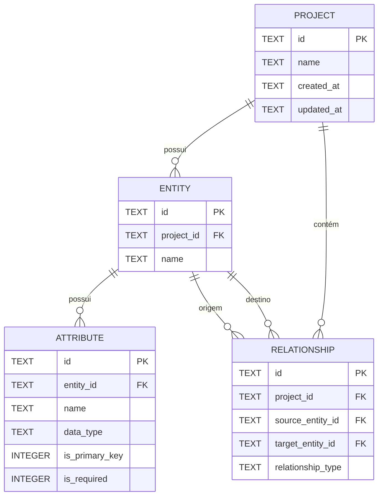

# Documento de Arquitetura de Software — BRMM (BRModelo Mobile)

## 1. Visão Geral da Arquitetura

O **BRMM (BRModelo Mobile)** adota uma arquitetura em camadas orientada a componentes, com abordagem **Local-First (100% Offline)**. Toda a computação, manipulação de regras de negócio e armazenamento residem exclusivamente no dispositivo móvel do usuário.



---

## 2. Decisões Tecnológicas e Justificativas

| Tecnologia | Decisão | Justificativa |
| :--- | :--- | :--- |
| **Interface Mobile** | **React Native + Expo** | Permite desenvolvimento multiplataforma (Android e iOS) com excelente performance de renderização nativa, ciclo ágil de desenvolvimento via Expo Go e amplo ecossistema de bibliotecas estáveis. |
| **Linguagem** | **JavaScript (ES6+)** | Elimina complexidade de configuração e etapas de compilação adicionais no MVP, garantindo prototipagem rápida e aderência direta às diretrizes do projeto. |
| **Persistência Local** | **SQLite (`expo-sqlite`)** | Banco de dados relacional embarcado no próprio dispositivo. Fornece ACID completo, integridade referencial com chaves estrangeiras, consultas eficientes e persistência segura em arquivo local sem custo de infraestrutura. |
| **Backend Remoto** | **Nenhum (100% Local)** | O MVP tem como objetivo central a modelagem individual no dispositivo móvel. A ausência de backend remoto simplifica a arquitetura, reduz custos e garante funcionamento estritamente offline com máxima privacidade. |
| **Testes Automatizados** | **Jest + Jest Expo** | Padrão da comunidade React Native para testes unitários e de integração de serviços, validadores e lógica de negócios. |
| **Controle de Versão** | **Git + GitHub** | Controle de versões distribuído, rastreabilidade de commits semânticos e base para automação de pipelines. |

---

## 3. Organização de Diretórios e Módulos

A aplicação Expo está centralizada no diretório `brmodelo-mobile/`, com a seguinte estrutura lógica:

```
brmodelo-mobile/
├── assets/                     # Ícones, fontes e recursos visuais estáticos
├── src/
│   ├── components/             # Componentes visuais reutilizáveis (botões, modais, cartões)
│   ├── screens/                # Telas da aplicação (HomeScreen, ProjectScreen, EntityScreen, etc.)
│   ├── navigation/             # Configurações de navegação de telas
│   ├── database/               # Conexão SQLite, migrations DDL e execução de queries
│   ├── models/                 # Definições de entidades, contratos de dados e esquemas
│   ├── services/               # Regras de negócio (ProjectService, EntityService, RelationshipService)
│   ├── hooks/                  # React Hooks customizados para gerenciamento de estado e ciclo de vida
│   ├── utils/                  # Funções utilitárias (validações, formatação de datas)
│   └── constants/              # Constantes do sistema (tipos de dados de atributos, cardinalidades, temas)
├── App.js                      # Ponto de entrada do aplicativo Expo
├── app.json                    # Metadados e configurações da plataforma Expo
└── package.json                # Manifesto de dependências e scripts do Node.js
```

### Responsabilidades das Camadas:
- **`screens/`**: Telas de visualização que orquestram a interface e invocam os serviços.
- **`components/`**: Elementos de UI desacoplados (ex.: `ProjectCard`, `AttributeItem`, `ConfirmModal`).
- **`services/`**: Concentra a lógica de validação de negócios (ex.: validação de nomes únicos, verificação de entidades antes de relacionar) e orquestra chamadas ao banco.
- **`database/`**: Inicializa o arquivo SQLite local, executa scripts de criação de tabelas e expõe operações SQL parametrizadas.
- **`utils/`**: Funções puras de formatação de data, validação de inputs e sanitização de texto.

---

## 4. Modelagem de Dados Local (Schema SQLite)

O banco de dados SQLite interno do aplicativo armazena as estruturas criadas pelo usuário. O esquema relacional do banco interno é composto por 4 tabelas fundamentais:



### 4.1. Definições das Tabelas DDL

1. **Tabela `projects`:**
   ```sql
   CREATE TABLE IF NOT EXISTS projects (
       id TEXT PRIMARY KEY,
       name TEXT NOT NULL,
       created_at TEXT NOT NULL,
       updated_at TEXT NOT NULL
   );
   ```

2. **Tabela `entities`:**
   ```sql
   CREATE TABLE IF NOT EXISTS entities (
       id TEXT PRIMARY KEY,
       project_id TEXT NOT NULL,
       name TEXT NOT NULL,
       FOREIGN KEY (project_id) REFERENCES projects(id) ON DELETE CASCADE
   );
   ```

3. **Tabela `attributes`:**
   ```sql
   CREATE TABLE IF NOT EXISTS attributes (
       id TEXT PRIMARY KEY,
       entity_id TEXT NOT NULL,
       name TEXT NOT NULL,
       data_type TEXT NOT NULL,
       is_primary_key INTEGER NOT NULL DEFAULT 0,
       is_required INTEGER NOT NULL DEFAULT 0,
       FOREIGN KEY (entity_id) REFERENCES entities(id) ON DELETE CASCADE
   );
   ```

4. **Tabela `relationships`:**
   ```sql
   CREATE TABLE IF NOT EXISTS relationships (
       id TEXT PRIMARY KEY,
       project_id TEXT NOT NULL,
       source_entity_id TEXT NOT NULL,
       target_entity_id TEXT NOT NULL,
       relationship_type TEXT NOT NULL,
       FOREIGN KEY (project_id) REFERENCES projects(id) ON DELETE CASCADE,
       FOREIGN KEY (source_entity_id) REFERENCES entities(id) ON DELETE CASCADE,
       FOREIGN KEY (target_entity_id) REFERENCES entities(id) ON DELETE CASCADE
   );
   ```

> [!NOTE]
> `PRAGMA foreign_keys = ON;` é ativado em todas as conexões SQLite para garantir a integridade referencial e o comportamento de `ON DELETE CASCADE`.

---

## 5. Estratégia de Versionamento Git e GitHub

- **Branch Principal (`main`):** Contém código estável, testado e documentado.
- **Branches de Funcionalidade (`feature/<nome-funcionalidade>`):** Branches criadas a partir da `main` para desenvolvimento isolado de cada funcionalidade.
- **Branches de Correção (`fix/<nome-da-correcao>`):** Para correção pontual de defeitos identificados.
- **Padrão de Mensagens de Commit (Conventional Commits):**
  - `feat: adiciona criacao de entidades no project service`
  - `fix: corrige validacao de campos em branco no formulario de atributos`
  - `docs: adiciona especificacao de casos de uso`
  - `test: implementa testes unitarios para validacao de relacionamento`

---

## 6. Plano de Testes Automatizados

1. **Testes Unitários:**
   - Foco nas funções utilitárias (`utils/validation.js`, `utils/formatters.js`).
   - Foco nos serviços de domínio (`services/projectService.js`, etc.), validando regras de unicidade de nomes, tipos permitidos e integridade referencial.
2. **Framework de Testes:**
   - **Jest**: Motor de execução de testes, mocks e asserções.
3. **Mocks de Persistência:**
   - Simulação da camada de banco de dados (`expo-sqlite`) em ambiente Node de testes para permitir testes de serviço ágeis e determinísticos sem necessidade de emulador móvel.

---

## 7. Pipeline de CI/CD (GitHub Actions) e Planejamento DevSecOps

### 7.1. Pipeline de Integração Contínua (CI)
Será configurado em `.github/workflows/ci.yml` quando os testes e linters forem ativados no projeto:
- **Gatilhos:** Execução automática em `push` na branch `main` e em qualquer `pull_request`.
- **Passos do Pipeline:**
  1. *Checkout* do repositório.
  2. Configuração do ambiente Node.js (versão LTS).
  3. Instalação das dependências (`npm ci`).
  4. Execução de linting estático com ESLint (`npm run lint`).
  5. Auditoria de vulnerabilidades de dependências (`npm audit --audit-level=high`).
  6. Execução de testes automatizados unitários (`npm test`).

### 7.2. Práticas de DevSecOps
- **Auditoria Contínua de Dependências:** Uso periódico do `npm audit` para mitigar vulnerabilidades em pacotes de terceiros.
- **Prevenção de SQL Injection:** Uso absoluto de consultas preparadas (*prepared queries*) com passagem de parâmetros por tuplas e placeholders (`?`), nunca concatenando strings diretamente em instruções SQL.
- **Sanitização e Validação no Cliente:** Validação de formato, comprimento máximo e restrições de nulidade antes de atingir a camada de banco de dados.
- **Privacidade por Design (Privacy-by-Design):** O aplicativo não requer dados pessoais nem comunicações com servidores externos no MVP, preservando integralmente a privacidade do usuário no dispositivo.
